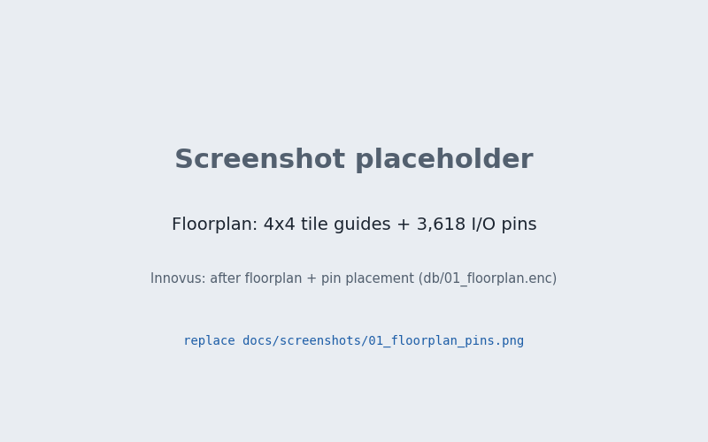
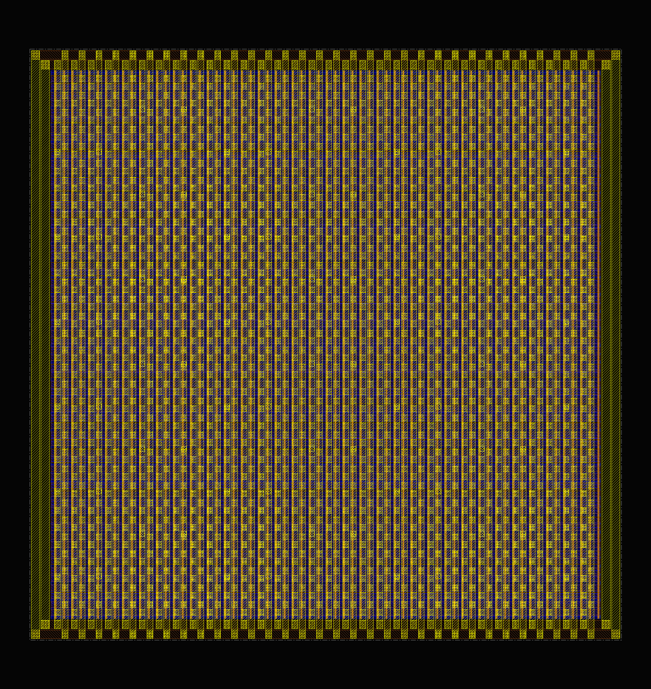
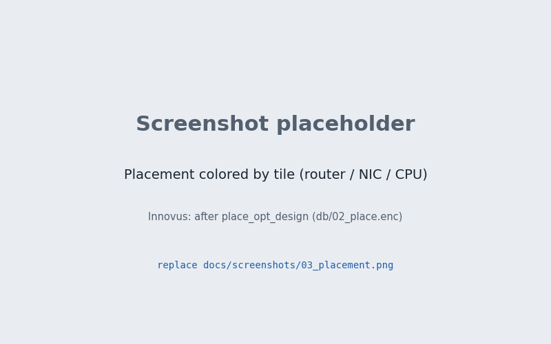
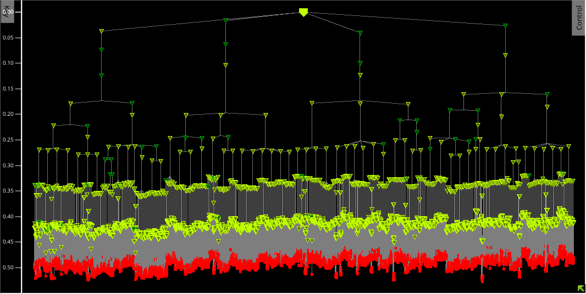
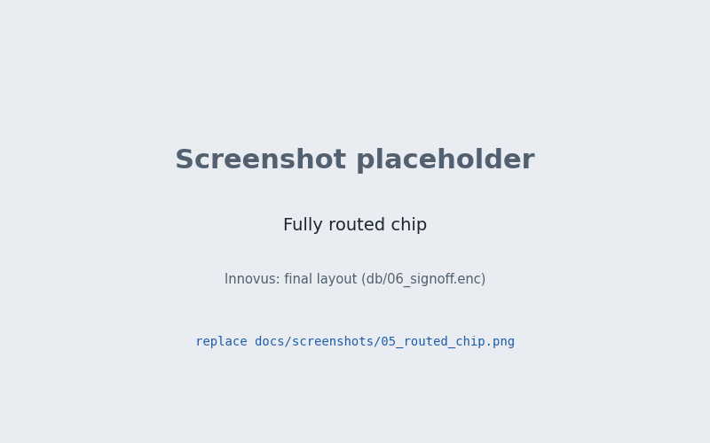
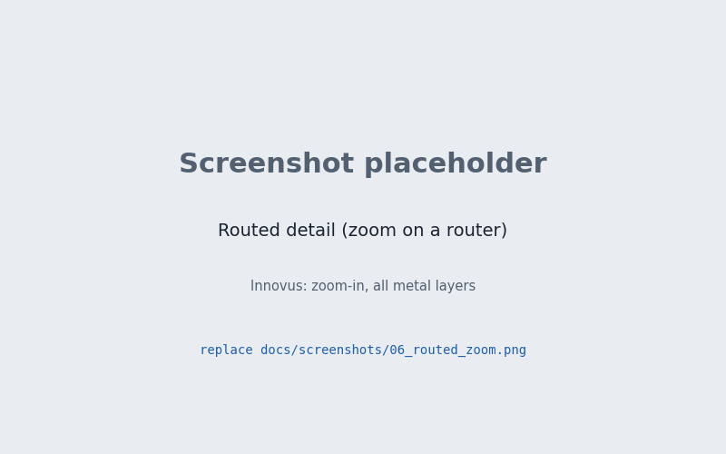
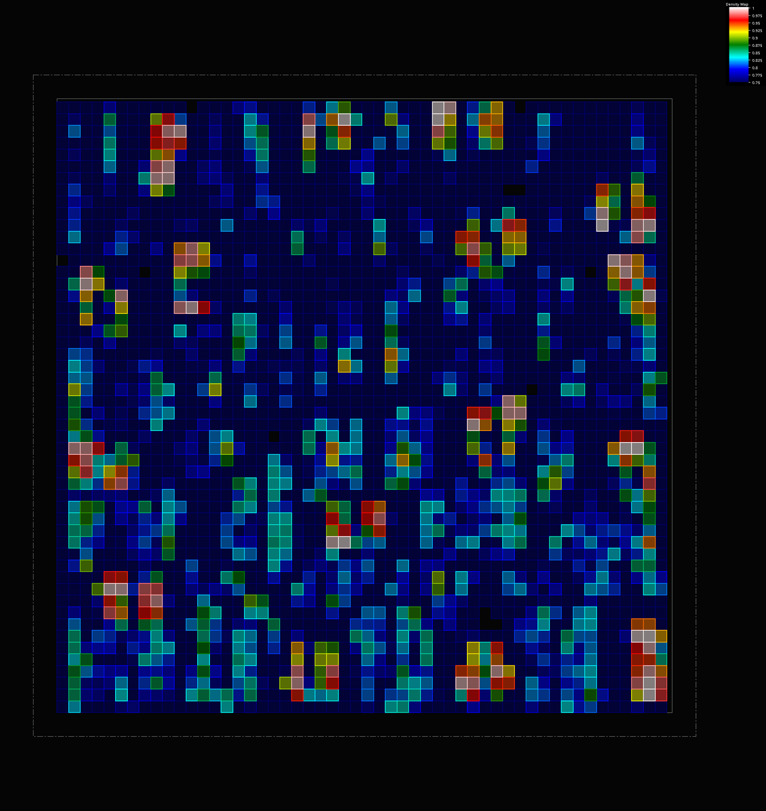
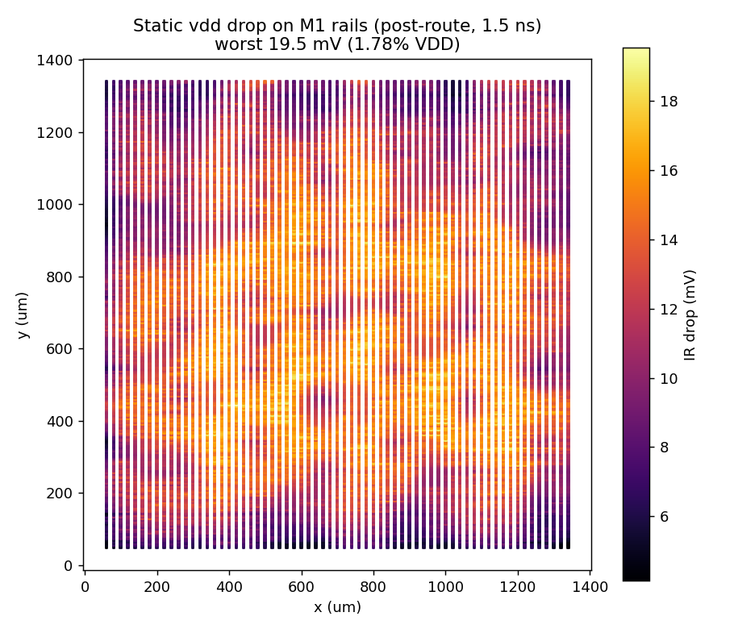
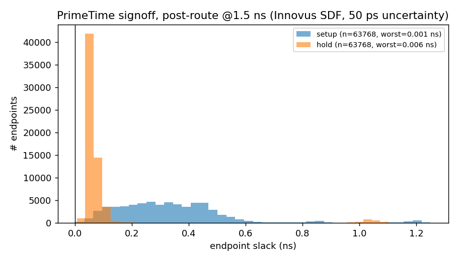

# 4×4 Mesh Network-on-Chip for a 16-Core Chip Multiprocessor

16 small 64-bit SIMD processors connected by a 4×4 mesh NoC. I took it from RTL to a routed, signed-off layout in FreePDK45 (45 nm), using Design Compiler, Innovus, PrimeTime, Conformal, and Xcelium. This started as a course project (USC EE577B), and I kept going on the implementation side well past what the class required.

## Results

- Synthesis closes at 1.15 ns (870 MHz). The limit there is the 1 ns I/O budget, not internal logic.
- Post-route signoff at 1.5 ns (667 MHz): no setup or hold violations in PrimeTime, no DRC, no max-cap or max-transition violations.
- 1.24M µm² of cells, about 360K cells and 66K flops, on a 1.4 × 1.4 mm die.
- Full scan with 16 chains. Stuck-at fault coverage is 99.9%.
- Worst static IR drop is 1.8% of VDD.
- The netlist matches the RTL in formal checks (Conformal LEC), both after synthesis and after routing.

The original version of this design needed 4.89M µm² and only routed at 100 ns. Most of the improvement came from the RTL: an iterative SIMD multiply/divide/sqrt unit replaced 30 DesignWare pipelines per core, and the CPU became a 6-stage pipeline where every chip output comes straight from a flop.

## Design

Each mesh node has a CPU, a network interface, and a router. Routers use XY routing with two virtual channels, picked by a polarity bit that flips every cycle, so the network can't deadlock. The CPU talks to the NIC through memory-mapped registers.

```
 [CPU] <-> [NIC] <-> [Router] <-> N/S/E/W neighbours
   |
 imem / dmem ports (chip I/O)
```

## Implementation notes

**Synthesis.** I compiled the router, NIC, and CPU once each and then built the top level. That alone missed timing at 1.5 ns, because the router-to-NIC handshake is combinational across block boundaries. Re-optimizing the routers and NICs in the context of the full chip fixed it, and also cut area by about 17%.

**Scan.** The standard-cell library has no scan flops, so I added a mux in front of every flop myself in DC and stitched one chain per tile. For ATPG I used Atalanta, an open-source tool, plus a small converter that turns the post-route netlist into its input format. The design is split per tile, and each tile includes the logic from its neighbours that drives or observes its boundary. I checked the generated patterns on the real post-route netlist in Xcelium: about 670K captured bits, all matching.

The faults ATPG couldn't test pointed at dead logic. The NIC only sends on one polarity, but the router only fills one of its input buffers on the other polarity, so that buffer can never be written from the NIC.

**Floorplan.** The floorplan follows the mesh. Each node's three blocks are guided into one tile of a 4×4 grid, so router links stay short. The I/O pins of each node sit on the die edge next to that node's tile.

**Power grid.** My first grid had about 21% IR drop at the center of the die. I wrote a small IR-drop solver: it pulls the power wires, vias, and per-cell power out of Innovus and solves the resistor network in Python. I used it to iterate on the grid. The final grid uses wide M9/M10 straps, narrow M6 straps that connect down to the cell rails, and area-array power bumps, which bring the worst drop to 1.8%.

**Things that took the longest to debug.**

- The library's flip-flop setup tables have entries of several nanoseconds at higher clock slews. That is invisible with an ideal clock, but after CTS the worst slack fell from +0.002 ns to −2.6 ns. I patched the tables and kept the clock slew low.
- Seven cells in the library have `max_capacitance = 0`, which flags every net they drive as a violation.
- The SDF files use edge-specific delay arcs that the simulation models don't declare. The simulator silently fell back to default delays, so gate-level sims failed only at certain clock periods and never reported a timing error. [`scripts/sdf_noedge.py`](scripts/sdf_noedge.py) rewrites the SDF so every delay is applied.

## Innovus screenshots

<!-- Replace each file in docs/screenshots/ with a real Innovus screenshot using the same file name; this README does not need to change. -->

| Floorplan, tile guides, and I/O pins | Power grid |
|---|---|
|  |  |

| Placement | Clock tree |
|---|---|
|  |  |

| Routed chip | Routed detail |
|---|---|
|  |  |

| Congestion / density map |
|---|
|  |

## Plots

Static IR drop on the M1 rails, from my solver. PrimeTime slack for every endpoint after routing.

| IR drop (vdd) | Post-route slack |
|---|---|
|  |  |

## Repository

```
design/            RTL
cardinal_cmp.tcl   synthesis script
scripts/           scan insertion, Innovus P&R, PrimeTime, Conformal, IR-drop tools
dft/atpg/          ATPG model converter and pattern-validation testbenches
sim/, tb/          simulation scripts, scan-chain testbench
reports/           timing, area, power, LEC, ATPG, and IR reports
docs/              screenshots, plots, and a longer write-up (in Chinese)
```

The scripts expect the FreePDK45 kit and a `setup_ee577b_v26.sh` with your tool paths (see the `.template` file). The course testbench, test programs, and memory models aren't included, and neither are the PDK files or large layout outputs (GDS, DEF, SPEF).

## What's missing

- ATPG covers stuck-at faults only. There are no at-speed (transition) faults and no test compression.
- IR drop is static, using estimated switching activity.
- I only had one timing corner, since the library provides just one.
