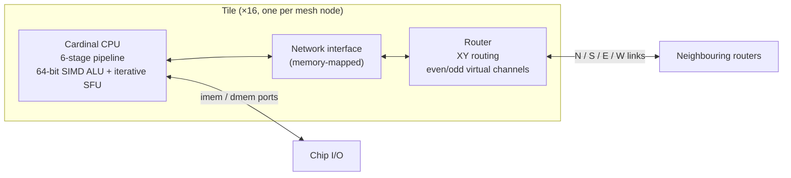
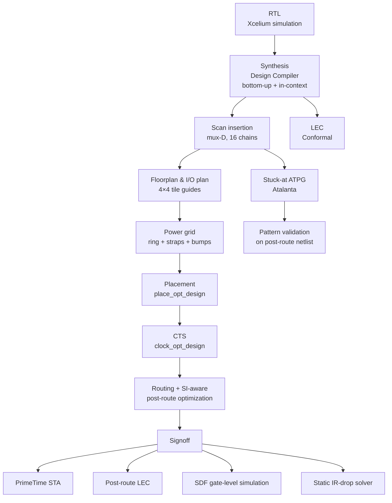
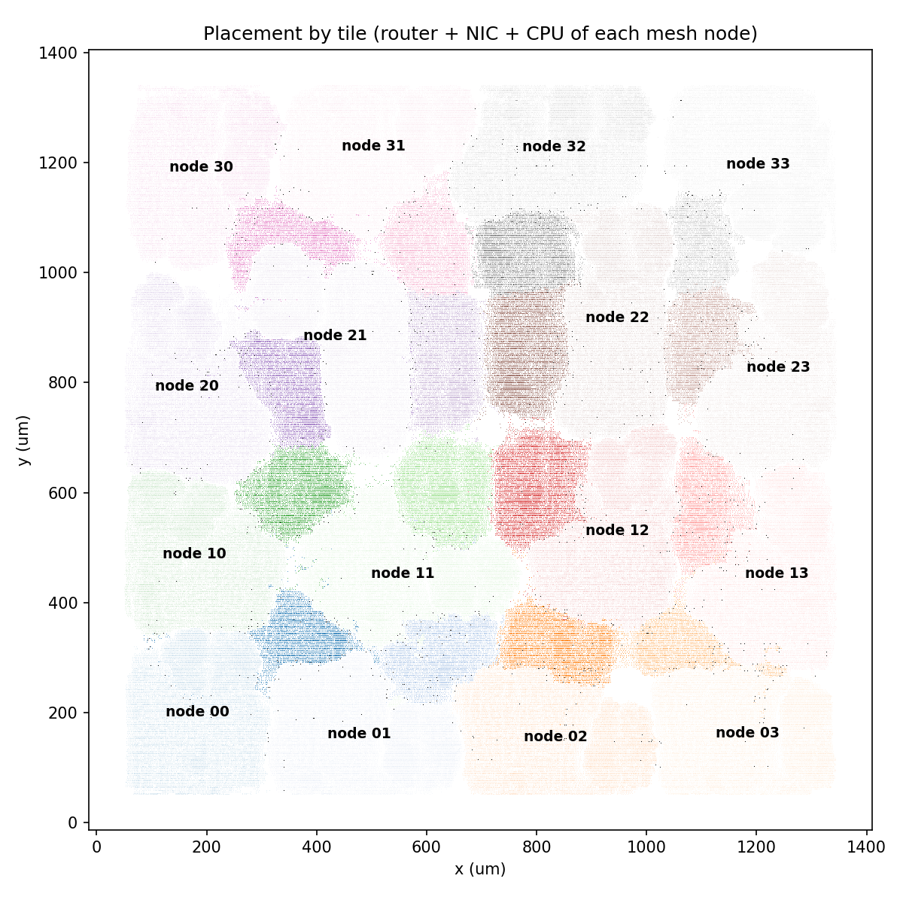
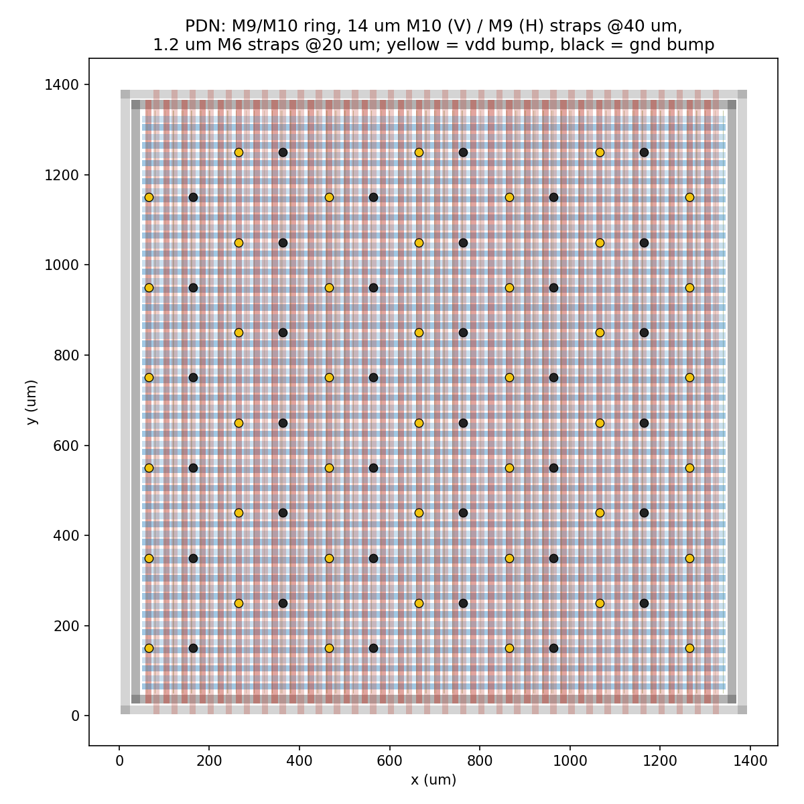

# 4×4 Mesh Network-on-Chip for a 16-Core Chip Multiprocessor

A 16-core chip multiprocessor connected by a deadlock-free 4×4 mesh network-on-chip, taken from RTL to signed-off GDSII in the NCSU FreePDK45 (45 nm) process. The project covers the complete ASIC flow: logic synthesis, scan insertion and stuck-at ATPG, floorplanning, power-grid design with IR-drop analysis, place and route, clock tree synthesis, and signoff with formal equivalence checking, static timing analysis, and post-layout gate-level simulation.

| Metric | Result |
|---|---|
| Design size | 16 CPUs + 16 NICs + 16 routers · ~360K standard cells · 66,304 flip-flops |
| Synthesis | **1.15 ns (870 MHz)**, 1.241M µm², area-delay product 1.43M µm²·ns |
| Place & route | **1.5 ns (667 MHz)** post-route signoff, 1.40 × 1.39 mm die |
| Timing signoff | 0 setup / 0 hold violations over 63,768 endpoints (PrimeTime) |
| Physical signoff | 0 DRC, 0 max-cap / max-transition / max-fanout violations |
| Clock tree | 66K sinks, 82 ps skew, 0.49 ns average insertion delay |
| Power integrity | 1.8 % worst static IR drop (vdd), 2.4 % (gnd) at 1.85 W |
| DFT | Full scan, 16 chains × 4,144 flops; **99.90 % stuck-at fault coverage**, 99.997 % test coverage over 3.67M faults |
| Equivalence | RTL ≡ synthesis ≡ post-route netlist (Conformal LEC), functional and scan versions |
| Versus the original design | cell area −75 % (4.89M → 1.24M µm²), area-delay product 34× better |

---

## Architecture



- **Network**: 4×4 mesh, dimension-ordered (XY) routing, two virtual channels selected by a global polarity bit that alternates every cycle, which keeps the network deadlock-free.
- **Processor**: 6-stage pipeline (IF, ID, EX, MEM, WB, RF). Every output port is driven directly by a flip-flop and every input port reaches a flip-flop through at most one mux, so the chip I/O timing budget is met by construction. Forwarding comes only from pipeline registers.
- **SIMD unit**: 8/16/32/64-bit lane multiply, divide, and square root share one segmented adder in an iterative unit. It replaced 30 DesignWare divider and square-root pipelines per core and is the main reason the area dropped by 75 %.

## Implementation flow



| Stage | Tool |
|---|---|
| Simulation | Cadence Xcelium 25.09 |
| Synthesis and scan insertion | Synopsys Design Compiler Y-2026.03 |
| Place and route | Cadence Innovus 25.1 |
| RC technology file | Cadence Quantus Techgen (generated from the FreePDK45 stack) |
| Static timing analysis | Synopsys PrimeTime Y-2026.03 |
| Equivalence checking | Cadence Conformal LEC 25.2 |
| ATPG | Atalanta 2.0 (open source) with a custom netlist-to-test-model converter |
| IR-drop analysis | Custom sparse-matrix solver (Python, SciPy) on Innovus database exports |

---

## 1. Synthesis

Bottom-up synthesis: the router, NIC, and CPU are each compiled once and instantiated 16 times, then the top level is compiled with the blocks fixed. The router-to-NIC handshake is combinational across block boundaries, so a final in-context pass re-optimizes the 16 routers and NICs in the full-chip context. That pass recovered 0.24 ns of slack and 17 % of area.

Constraints follow the specification: 1.0 ns input and output delay and 0.5 ns clock latency. A period sweep found 1.15 ns as the smallest passing period. At 1.1 ns the only failing paths are flip-flop-to-output-port paths whose clock-to-Q delay alone exceeds the output budget, so 1.15 ns is the I/O-limited floor ([`reports/syn/period_sweep.txt`](reports/syn/period_sweep.txt)).

## 2. Design for test

**Scan insertion.** The standard-cell library has no scan flip-flops, so DFT Compiler cannot scan-replace. Scan is inserted by netlist editing in Design Compiler: each flip-flop gets a MUX2X1 + INVX1 front end (`D = SE ? SI : D_func`). Chains are stitched hierarchically, one per tile (router → NIC → CPU), giving 16 chains of 4,144 flops. Functional timing still closes at 1.15 ns with `set_case_analysis 0 test_se`.

**ATPG and fault coverage.**

- Stuck-at ATPG runs on the post-route scan netlist.
- A converter written for this project (`dft/atpg/net2bench.py`) turns the gate-level netlist into a full-scan combinational test model: flip-flop outputs become pseudo-primary inputs and flip-flop inputs become pseudo-primary outputs. The fault universe is every pin of every non-clock cell, both stuck-at values.
- The chip is split into 16 tile partitions. Each partition includes the exact logic cones across its boundary, back to the neighbouring scan flip-flops, so the per-tile results match full-chip ATPG under the single-fault model.

| Class | Faults |
|---|---|
| Detected by ATPG | 3,500,687 |
| Detected by the chain (flush) test: clock-tree cells, flip-flop clock pins | 167,024 |
| Proven redundant | 3,399 |
| Aborted | 110 |
| **Fault coverage / test coverage** | **99.904 % / 99.997 %** |

The redundancy analysis found real dead logic. The NIC only injects packets while `polarity == 0`, but the router writes its even virtual-channel buffer only while `polarity == 1`, so that write path can never be exercised. This is feedback the RTL can use.

**Validation.**

- The patterns were simulated on the post-route netlist with SDF in Xcelium, using parallel-load simulation on three tiles: 670,592 captured bits, 0 mismatches against the predicted responses.
- 150 faults injected with `force` all behaved as predicted.
- Scan-chain integrity was verified separately with a flush test before and after layout.

## 3. Physical design

**Floorplan and I/O planning.**

- The floorplan mirrors the mesh: each node's router, NIC, and CPU go into a soft instance-group guide in the matching tile of a 4×4 grid, so every router link is a neighbour-to-neighbour hop.
- The 3,618 I/O pins sit on the die edge next to their tile. Each edge is split into four tile-wide segments; corner nodes take two segments, and inner nodes share a segment with the edge node in front of them. The layout is rotationally symmetric.
- Pins alternate between two routing layers at track-multiple pitch, and all 3,618 pass the legality check.

**Power grid and IR drop.**

| Power grid | Supply | Load | Worst static drop (vdd) |
|---|---|---|---|
| First version: 2.5 µm M9/M10 straps every 40 µm | core ring | 1.08 W (trial placement) | 21.6 % |
| Hierarchical: 10 µm M9/M10 global straps + 1.2 µm M6 local straps | core ring | 1.25 W uniform estimate | 10.8 % |
| 14 µm M9/M10 global straps + M6 local straps | core ring | 1.25 W uniform estimate | 8.1 % |
| **Final: 14 µm straps + area-array (flip-chip) power bumps every ~200 µm** | ring + bumps | **1.85 W post-route** | **1.8 %** |

- The wide global straps connect only down to the M6 straps. They never stack straight to the M1 rails, so M2–M8 routing tracks are blocked only under the narrow straps.
- IR drop is computed by a sparse-matrix solver written for this project. It reads the PG wires, vias (with cut counts), and per-instance power exported from Innovus.

**Timing closure.**

- Clock tree: 7,998 buffers, 82 ps skew, 0.49 ns average insertion delay, which matches the 0.5 ns latency assumed during synthesis.
- I/O is constrained against a virtual clock carrying that latency, so the synthesis I/O budget still holds after CTS.
- Routing uses a QRC technology file generated with Quantus Techgen from the FreePDK45 interconnect stack, for coupling-aware extraction and SI-aware delay calculation.
- A filler-aware post-route ECO fixes the last hold violations.

### Generated plots

| Placement by tile | Power grid |
|---|---|
|  |  |

| Static IR drop (vdd, ring + bumps) | Post-route slack histogram |
|---|---|
|  |  |

### Innovus screenshots

<!-- Replace each file in docs/screenshots/ with a real Innovus screenshot using the same file name; this README does not need to change. -->

| Floorplan, tile guides, and I/O pins | Power grid |
|---|---|
|  |  |

| Placement | Clock tree |
|---|---|
|  |  |

| Routed chip | Routed detail |
|---|---|
|  |  |

| Congestion / density map |
|---|
|  |

## 4. Signoff and verification

| Check | Netlist | Result |
|---|---|---|
| Functional simulation (16-node all-to-all traffic test) | RTL, synthesis + SDF, post-route + SDF at 1.5 ns | Pass, 0 timing-check violations |
| Equivalence checking | Synthesis, post-route, scan, scan post-route | Pass; an injected inverter is caught as exactly one non-equivalent output |
| Static timing | Post-route, Innovus SDF | 0 setup / 0 hold violations |
| Scan flush test | Scan netlist, pre- and post-layout + SDF | 134,656 bits, 0 errors |
| ATPG pattern validation | Post-route scan netlist + SDF | 670,592 captured bits, 0 mismatches |
| Physical verification | Final layout | 0 DRC violations |

## 5. Problems found and fixed

- **Liberty characterization errors.** Seven cells had `max_capacitance : 0`, which turns every net they drive into a design-rule violation (the root of the original design's 29,140 max-cap violations after P&R). The flip-flop setup tables contained entries of up to 6.2 ns, so once the real clock slew appeared after CTS, the worst slack dropped from +0.002 ns to −2.6 ns. Both were fixed in a corrected library and documented in its header.
- **SDF and simulation-model mismatch.** The SDF files used edge-qualified delay paths that the cell simulation models do not declare. The simulator silently replaced them with default delays, which caused failures that appeared only at some clock periods and raised no timing-check errors. A conversion script ([`scripts/sdf_noedge.py`](scripts/sdf_noedge.py)) keeps all delays and preserves edge-specific timing checks.
- **Equivalence checking after DC optimizations.** DC merged duplicate registers and stored the router polarity flip-flop inverted. Conformal resolved both with sequential-merge analysis and phase mapping.
- **Implementation-tool pitfalls.** A script procedure named `try` shadowed the Tcl built-in and made placement exit silently. After `place_opt_design`, the database requires `clock_opt_design` instead of `ccopt_design`. Hold violations introduced after filler insertion had to be fixed with the fillers removed.

## Repository layout

```
design/        RTL (CPU, ALU, SIMD unit, register file, NIC, router, mesh, top)
cardinal_cmp.tcl   Design Compiler synthesis (bottom-up + in-context)
scripts/       scan insertion, Innovus P&R (pnr.tcl, pnr_floorplan.tcl), PrimeTime,
               Conformal LEC, IR-drop dump and solver, SDF conversion, plotting
dft/atpg/      ATPG model builder, result aggregation, pattern validation testbenches
sim/, tb/      simulation runners and the scan flush-test testbench
lib/           FreePDK45 interconnect stack (ICT) used to build the QRC tech file
reports/       synthesis, P&R, timing, LEC, ATPG, IR-drop, and simulation results
docs/          figures, Innovus screenshots, full implementation report (Chinese)
Makefile       entry points for every flow step
```

## Reproducing

The scripts expect a `setup_ee577b_v26.sh` in the repository root (see [`setup_ee577b_v26.sh.template`](setup_ee577b_v26.sh.template)) with license servers and tool paths, plus the NCSU FreePDK45 kit and the OSU `gscl45nm` standard-cell library installed at `/tools/PDK/NCSU45PDK`. Typical entry points:

```
make syn P=1.15            # synthesis at a 1.15 ns clock
make dft DP=1.15           # scan insertion
make pnr P=1.15 PP=1.5     # place and route at 1.5 ns
make lec P=1.15            # equivalence checking (plus the negative test)
```

Not included:

- The course-provided memory models, test programs, and testbench.
- The PDK and libraries.
- The generated QRC file.
- Large tool outputs: GDS, DEF, SPEF, SDF, and netlists.

## Limitations

- **ATPG scope.** Stuck-at faults only, generated with an open-source ATPG; no transition (at-speed) faults and no test compression.
- **IR drop.** Static analysis with vectorless power (0.2 activity); no dynamic IR or electromigration analysis.
- **Corners.** A single typical corner, the only one the library provides.
- **Power bumps.** Modelled as power pins on the top metal; there is no redistribution-layer or bump-cell layout.
