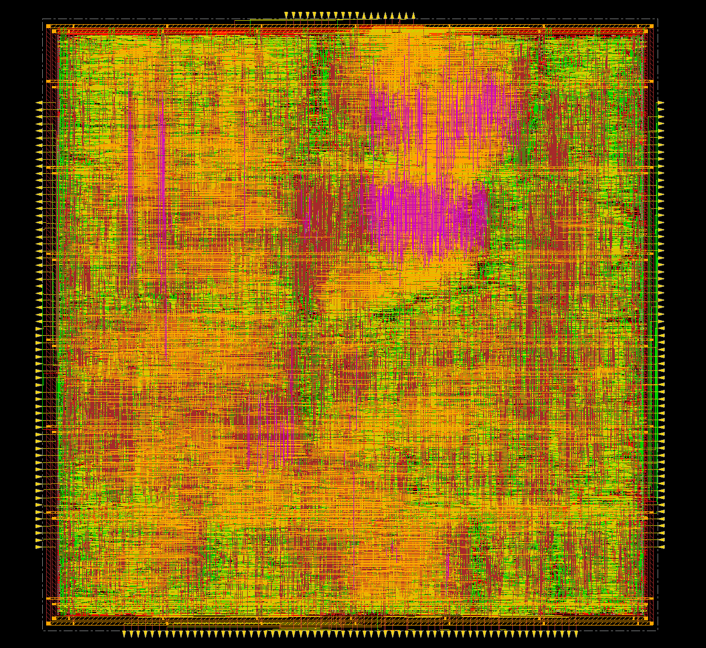

# 4×4 Mesh Network-on-Chip for a 16-Core Chip Multiprocessor

16 small 64-bit SIMD processors connected by a 4×4 mesh NoC. I took it from RTL to a routed, signed-off layout in FreePDK45 (45 nm), using Design Compiler, Innovus, PrimeTime, Conformal, and Xcelium. This started as a course project (USC EE577B), and I kept going on the implementation side well past what the class required.

## Results

- Synthesis closes at 1.15 ns (870 MHz). The limit there is the 1 ns I/O budget, not internal logic.
- Post-route signoff at 1.5 ns (667 MHz): no setup or hold violations in PrimeTime, no DRC, no max-cap or max-transition violations.
- 1.24M µm² of cells, about 360K cells and 66K flops, on a 1.4 × 1.4 mm die.
- Full scan, 16 chains × 4,144 flops. Stuck-at fault coverage is 99.9% over 3.67M faults, and the patterns were checked on the post-route netlist.
- Worst static IR drop is 1.8% of VDD.
- The netlist matches the RTL in formal checks (Conformal LEC), both after synthesis and after routing.

The original version of this design needed 4.89M µm² and only routed at 100 ns. Most of the improvement came from the RTL: an iterative SIMD multiply/divide/sqrt unit replaced 30 DesignWare pipelines per core, and the CPU became a 6-stage pipeline where every chip output comes straight from a flop.

## Design

Each mesh node has a CPU, a network interface, and a router. Routers use XY routing with two virtual channels, picked by a polarity bit that flips every cycle, so the network can't deadlock. The CPU talks to the NIC through memory-mapped registers.

```
 [CPU] <-> [NIC] <-> [Router] <-> N/S/E/W neighbours
   |
 imem / dmem ports (chip I/O)
```

## Implementation notes

**Synthesis.** I compiled the router, NIC, and CPU once each and then built the top level. That alone missed timing at 1.5 ns, because the router-to-NIC handshake is combinational across block boundaries. Re-optimizing the routers and NICs in the context of the full chip fixed it, and also cut area by about 17%.

**Floorplan.** The floorplan follows the mesh. Each node's three blocks are guided into one tile of a 4×4 grid, so router links stay short. The I/O pins of each node sit on the die edge next to that node's tile.

**Power grid.** My first grid had about 21% IR drop at the center of the die. I wrote a small IR-drop solver: it pulls the power wires, vias, and per-cell power out of Innovus and solves the resistor network in Python. I used it to iterate on the grid. The final grid uses wide M9/M10 straps, narrow M6 straps that connect down to the cell rails, and area-array power bumps, which bring the worst drop to 1.8%.

**Things that took the longest to debug.**

- The library's flip-flop setup tables have entries of several nanoseconds at higher clock slews. That is invisible with an ideal clock, but after CTS the worst slack fell from +0.002 ns to −2.6 ns. I patched the tables and kept the clock slew low.
- Seven cells in the library have `max_capacitance = 0`, which flags every net they drive as a violation.
- The SDF files use edge-specific delay arcs that the simulation models don't declare. The simulator silently fell back to default delays, so gate-level sims failed only at certain clock periods and never reported a timing error. [`scripts/sdf_noedge.py`](scripts/sdf_noedge.py) rewrites the SDF so every delay is applied.

## Design for test

### Scan architecture

The library has no scan flip-flops, so DFT Compiler can't scan-replace anything. I wrote the scan insertion as a DC Tcl script ([`scripts/dc_scan_insert.tcl`](scripts/dc_scan_insert.tcl)). It edits the netlist directly: every DFF gets a MUX2X1 + INVX1 in front of its D pin (the library's MUX is inverting), so `D = test_se ? SI : D_func`, and the chain stays non-inverting.

- Hierarchical insertion. The router, NIC, and CPU are each scanned once inside their shared block design (1,286 + 195 + 2,663 flops). At the top I stitched one chain per tile: `test_si[k] → router → NIC → CPU → test_so[k]`.
- That gives 16 chains of 4,144 flops, 66,304 scan cells in total. Every flop in the design is on a chain.
- New top-level ports: `test_se`, `test_si[15:0]`, `test_so[15:0]`.
- The design was easy to scan by construction. It has one clock driven straight from a pin, only synchronous resets, no latches, and no clock gating, so there were no DFT rule problems to work around.
- Cost: area went up 37% (1.24M → 1.70M µm²). After an incremental compile with `set_case_analysis 0` on `test_se`, functional timing still closed at 1.15 ns.

### Test mode in place and route

The scan version went through its own full Innovus run with two MMMC modes:

- Functional: 1.5 ns, `test_se = 0`.
- Shift: 10 ns, `test_se = 1`.

CTS and hold fixing used both views. Hold matters most in shift mode, where Q goes almost directly to the next flop's D. `test_se` fans out to every scan mux, and Innovus buffered it as a high-fanout net (about 600 buffers). The scan version closed at 1.5 ns with hold met in both modes. Two setup paths were left short by less than 1 ps.

### Scan verification

- Flush test ([`tb/tb_scan.v`](tb/tb_scan.v)). It shifts a random stream, then its complement, through all 16 chains and checks that each one comes out exactly 4,144 cycles later: 134,656 bits checked, 0 errors. I ran it on the synthesized and the post-route scan netlists, both with SDF.
- STA in shift mode with PrimeTime: no setup or hold violations.
- Conformal LEC with `test_se` held at 0 and `test_so` ignored. The scan netlist is equivalent to the original RTL, before and after routing.
- One thing I hit here: the Innovus `-edges noedge` SDF merges the rise and fall hold checks into the worse of the two. That showed a fake hold violation in the post-route flush test. Converting the SDF myself and keeping the edge-specific checks fixed it.

### ATPG

There's no commercial ATPG on the server (no TetraMAX or Modus), so I built the flow around Atalanta, an open-source FAN-based ATPG:

1. A converter ([`dft/atpg/net2bench.py`](dft/atpg/net2bench.py)) turns the post-route scan netlist into Atalanta's input format. Flop outputs become inputs and flop inputs become outputs (full-scan combinational model). Every cell pin gets its own node, so the fault list is stuck-at-0 and stuck-at-1 on every pin of every non-clock cell. That's the same uncollapsed count commercial tools report.
2. The full chip (about 550K cells) is too big to run in one piece, so I split it into the 16 tiles plus the top-level buffers. A simple split would treat signals crossing a tile boundary as freely controllable and observable, which overstates coverage. Each tile therefore also includes the neighbour logic that drives its inputs, traced back to the neighbour's scan flops, and the logic that its outputs feed, traced to the flops that capture them. This matches running the whole chip under the single-fault model.
3. I ran random patterns first, then deterministic FAN with backtrack limit 100 and a second phase with limit 1,000, then pattern compaction. The remaining faults got a second run with limits of 1,000 and 10,000.

| Fault class | Count |
|---|---|
| Detected by ATPG | 3,500,687 |
| Detected by the chain test (clock-tree cells, flop clock pins) | 167,024 |
| Proven untestable (redundant) | 3,399 |
| Aborted | 110 |
| Total | 3,671,220 |

Stuck-at fault coverage is 99.90%. Test coverage, which excludes the proven-untestable faults, is 99.997%. Compaction brought the pattern count down from about 20K to about 2,800 per tile. The full results are in [`reports/dft/`](reports/dft/).

Most of the untestable faults were in the router, and tracing them back pointed at a real design issue. The NIC only sends a packet when `polarity == 0`, but the router writes its even virtual-channel buffer from the NIC only when `polarity == 1`. That write path can never happen, so the faults on it can't be tested. The logic could be removed from the RTL.

### Checking the patterns on the real netlist

I didn't want to trust the converter blindly, so I checked the patterns in Xcelium on the post-route netlist with SDF.

- Simulating full scan load and unload for every pattern took about 5 minutes each on a 550K-cell chip. Instead I used parallel-load simulation: force every flop's D, clock once to load the state, apply the chip inputs, capture once, and read back every flop. Chain integrity was already covered by the flush test.
- Three tiles (a corner tile, an inner tile, and the tile with the largest boundary logic), 31 patterns each: 670,592 captured bits, all matching the predicted response.
- I also injected 150 sampled faults with `force` and checked that each one flipped exactly the flops the model predicted. One looked wrong at first. It sat on an input pin of a net with several loads, and Xcelium's `force` on the port acted on the whole net. Its effect matched the prediction for a stuck-at on the whole net exactly, so I only injected on single-load pins after that.

### Test time and what's missing

With the 16 chains shifting in parallel and each tile's patterns applied one after another, the test takes about 45K patterns × 4,145 cycles at a 10 ns shift clock, roughly 1.9 s. That's long, and the 4,144-flop chains are the bottleneck. With commercial tools the next steps would be:

- Test compression (EDT- or DFTMAX-style) with many more, shorter internal chains.
- Transition-fault (at-speed) ATPG with launch-on-capture.
- Merging patterns across tiles that don't share any scan cells.

## Innovus screenshots

| Floorplan, tile guides, and I/O pins | Power grid |
|---|---|
|  |  |

| Placement (one color per tile) | Clock tree |
|---|---|
|  |  |

| Final layout (after routing and signoff fixes) |
|---|
|  |

## Plots

Static IR drop on the M1 rails, from my solver. PrimeTime slack for every endpoint after routing.

| IR drop (vdd) | Post-route slack |
|---|---|
|  |  |

## Repository

```
design/            RTL
cardinal_cmp.tcl   synthesis script
scripts/           scan insertion, Innovus P&R, PrimeTime, Conformal, IR-drop tools
dft/atpg/          ATPG model converter and pattern-validation testbenches
sim/, tb/          simulation scripts, scan-chain testbench
reports/           timing, area, power, LEC, ATPG, and IR reports
docs/              screenshots, plots, and a longer write-up (in Chinese)
```

The scripts expect the FreePDK45 kit and a `setup_ee577b_v26.sh` with your tool paths (see the `.template` file). The course testbench, test programs, and memory models aren't included, and neither are the PDK files or large layout outputs (GDS, DEF, SPEF).

## What's missing

- ATPG covers stuck-at faults only and comes from an open-source tool, so the numbers may differ slightly from TetraMAX or Modus.
- IR drop is static, using estimated switching activity.
- I only had one timing corner, since the library provides just one.
